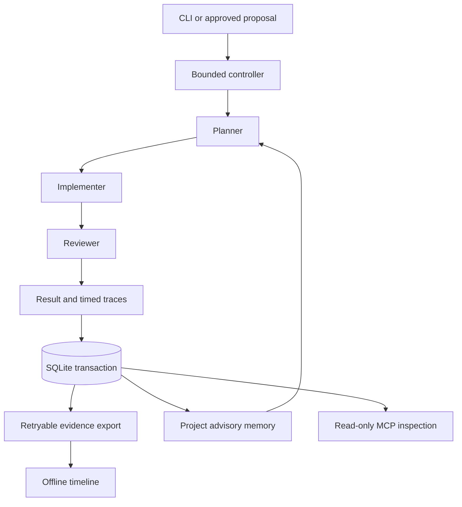

# Architecture and persistence contract

## Existing workflow preserved

The controller creates an owned disposable Git fixture, acknowledges a validated
inspection path, records a plan, applies the fixed normalize-label implementation,
checks the diff, and invokes the trusted SWARM-001 test. Approval requires the exact
five completed operations, one patch, a nonempty verified diff, and one passed test
with zero skipped tests. Unauthorized tools and failed operations terminate the run.
The original acceptance test contents are unchanged; hashing normalizes CRLF to LF
so repository checkout line-ending policy does not alter the integrity result.

## Database lifecycle

1. Migrations acquire `BEGIN IMMEDIATE`; DDL and version history commit together.
2. Starting a run serializes workflow lookup/create and insertion of the running row.
3. Execution occurs outside the database write transaction.
4. Finalization serializes agents, successful step tasks, traces, termination,
   final status, and the JSON evidence payload in one transaction.
5. Any exception or interruption inside a transaction rolls the unit back. A second
   finalization is rejected. A failed run's successful prefix stays successful.
6. Export writes run-specific files, replacing each through a flushed temporary file.
   The manifest is written last. Verification compares file bytes with durable JSON.

SQLite and the filesystem do not form one atomic transaction. A crash can leave
partial or missing exports; SQLite remains authoritative and export is retryable.
There is no promise of directory fsync/power-loss durability across every filesystem.
Timeline HTML is a derived view, regenerated separately and not part of the manifest.
A crash before finalization leaves a running row, not invented completion evidence.
Explicit recovery records failure, without guessing which partial steps executed.

Migration 1 is preserved. Migration 2 adds `(project, task)` keyed advisory memory
and source-run provenance. Existing runs survive the upgrade. Memory is written
only for a complete reviewed result in the same project; stored facts are bounded
and generated by the application. Memory-off performs no memory read or write.
The current memory task is only SWARM-001; it is not a general semantic memory store.

## Measurement

Operation durations use a monotonic clock; timestamps use UTC. Traces include rejected
attempts separately from completed steps. End-to-end execution timing includes
fixture creation and reviewer subprocess execution, but excludes DB finalization,
memory writes, export and timeline generation. Failed/denied attempts are labeled
`rejected` in this schema; termination identifies validation versus execution failure.

Evaluation uses one unpatched acceptance baseline, one warmup per arm, and paired
repeated runs with alternating order. The task and patch are identical across arms.
Do not infer generalization, LLM quality, or causal speedups from this microbenchmark.

## Deliberate limits

No hosted service, model API, vector database, network listener, tool marketplace,
recursive agent loop, or arbitrary patch generator. The MCP interface only inspects
finalized evidence; proposal loading is a local approval-controlled interface.

Disposable fixture repositories live under `.swarmos/work/` with unique short identifiers, separately from arbitrarily nested evidence output directories. This avoids a Windows Git initialization path-length failure observed during clean-checkout testing. These fixtures are ignored and retained for local inspection; they are not database evidence. Extremely long project-root paths remain a host limitation.
